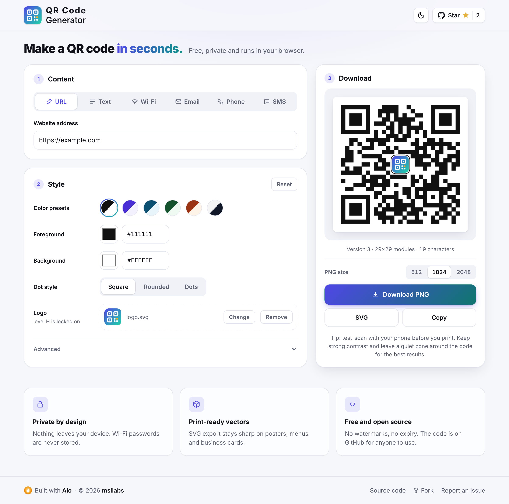

# qr-code-generator

This open-source project allows users to easily generate QR codes using a simple and responsive web interface.

## Demo

Check out the live demo: [QR Code Generator](https://msilabs.github.io/qr-code-generator/)

## Screenshots



## Features

- **User-Friendly:** Intuitive interface for seamless usage.
- **Responsive Design:** Works flawlessly on both mobile and desktop devices.
- **Free & Open Source:** Open for everyone to use and contribute.

## Prerequisites

To run this project, ensure you have:
- A modern web browser (e.g., Chrome, Firefox, Edge)

## Development

Built with [Alo](https://github.com/msilabs/alo). Node.js 22 or newer is needed.

```bash
npm install
npm run dev     # http://localhost:3000
npm run build   # site in dist/
```

For a sub-path such as GitHub Pages: `node alo build --base /qr-code-generator/`

## Deploy

The GitHub Actions workflow in `.github/workflows/pages.yml` builds the site and publishes `dist/`. In the repository settings, set Pages "Source" to "GitHub Actions".
